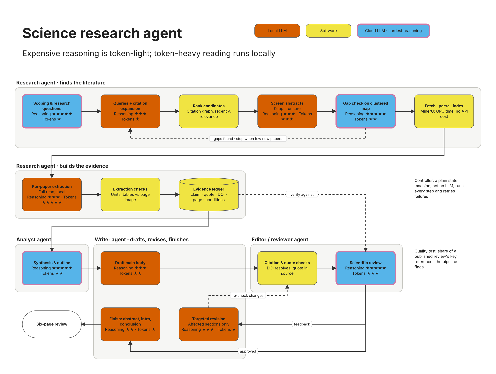

# research-agent

A science research agent designed to turn a topic into a rigorous review with traceable citations.

- **Research** discovers and screens papers, then extracts evidence for the ledger.
- **Analyst** identifies gaps, synthesizes evidence, and outlines the review.
- **Writer** drafts the review and makes targeted revisions.
- **Editor** verifies citations and quotations and reviews the draft against acceptance criteria.

The minimum version is **topic in, evidence ledger out**. The current CLI is a stub.

## Install and run

In PowerShell with Python 3.11 or later, run:

```powershell
py -m venv .venv
.\.venv\Scripts\python.exe -m pip install -e ".[dev]"
.\.venv\Scripts\research-agent.exe --help
.\.venv\Scripts\research-agent.exe run "Solid-state battery interfaces" --setup local
.\.venv\Scripts\python.exe -m pytest
```

The available setups are `premium`, `optimized`, `budget`, and `local`. The default is `optimized`.

## Pipeline diagram



[Open the SVG version of the whiteboard](docs/science_research_agent_whiteboard.svg).

## Project documents

- [Plan](plan.md)
- [Design decisions](design_decisions.md)
- [Engineering decisions](engineering_decisions.md)
- [Benchmark plan](benchmark.md)
- [Inspirations from prior work](inspirations_from_prior_work.md)
- [Cost model](docs/cost_model.md)
