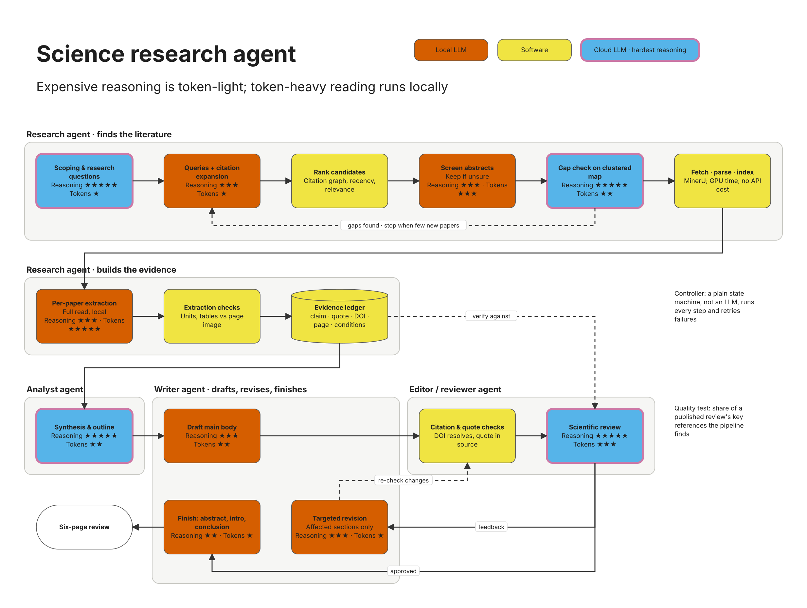

# Design decisions

What research-agent *is*: architecture, agents, model allocation. How it's built lives in `engineering_decisions.md`; how we test it lives in `benchmark.md`. Decision numbers run in one sequence across all three files.

## Architecture

Live whiteboard: https://claude.ai/artifact/QoEpAaVBPE6A8E1Bw37TQj

**Core idea:** expensive reasoning is token-light; token-heavy reading needs only moderate reasoning. So heavy reading runs locally (costs GPU time, not money) and cloud models get small, compact inputs for the hard thinking.

**Shape:** Hermes is the only free-roaming agent. It calls the `research-agent` CLI, where a plain state machine (not an LLM) runs 14 steps grouped into four agents. Each LLM step is a fixed call: given input, given prompt, strict output format. The only loops are capped ones: discovery rounds and revision rounds.

### Steps by agent (default setup: optimized)
| Agent | Step | Runs on | Reasoning | Tokens |
|---|---|---|---|---|
| Research | Scoping & research questions | Cloud: DeepSeek V4 Pro | ★★★★★ | ★ |
| Research | Queries + citation expansion | Local LLM + search APIs | ★★★ | ★ |
| Research | Rank candidates (citation graph, recency, relevance) | Software | none | none |
| Research | Screen abstracts (keep if unsure) | Local LLM | ★★★ | ★★★ |
| Research | Gap check on clustered list → back to queries | Cloud: DeepSeek V4 Pro | ★★★★★ | ★★ |
| Research | Fetch · parse · index (MinerU) | Software (GPU) | none | none |
| Research | Per-paper extraction (full read) | Local LLM | ★★★ | ★★★★★ |
| Research | Extraction checks (units, tables vs page image) | Software | ★ | ★ |
| Research | **Evidence ledger** (data store) | Software | none | none |
| Analyst | Synthesis & outline | Cloud: Claude Sonnet 5.5 | ★★★★★ | ★★ |
| Writer | Draft main body | Local LLM | ★★★ | ★★ |
| Editor | Citation & quote checks (DOI resolves, quote in source) | Software | none | none |
| Editor | Scientific review (claims vs ledger, writes acceptance tests) | Cloud: Gemini 4 Argon | ★★★★★ | ★★★ |
| Writer | Targeted revision (affected sections only) | Local LLM | ★★★ | ★ |
| Editor | Re-check (pass/fail against acceptance tests) | Cloud: Gemini 3.8 Flash | ★★ | ★ |
| Writer | Finish: abstract, intro, conclusion | Local LLM | ★★ | ★ |

Scoping and gap check are listed under Research because they steer the search; they use cloud models because they are the hardest reasoning in that agent.

### Evidence ledger
The central data store. One record per extracted claim: claim, verbatim quote, DOI, section, page, numbers + units, conditions (e.g. functional/basis set, gas phase vs solvent, ΔG vs ΔE, computed vs experimental, temperature), method, paper id.
- The writer cites ledger ids; the reviewer checks claim-to-entry links instead of re-reading papers; a revision only touches the affected entries.
- Provenance without relying on AI summaries.
- Synthesis gets a *compact* ledger (claim, numbers, conditions, id); quotes and pages stay local for the free automatic checks.
- Its accuracy is measured directly (D-023) before anything is built on it.
Next design task: the exact schema.

### Discovery
Full-text access is solved (D-008), so coverage is a discovery problem.
1. Seed queries from the scoping questions → OpenAlex, Semantic Scholar, Crossref, arXiv, ChemRxiv.
2. Citation expansion, 1 hop backwards and forwards from the strongest seeds. This finds recent work no model's training data contains.
3. Rank by citation-graph position + recency + relevance (maths, not an LLM).
4. Local screening biased to recall.
5. Cloud gap check on a clustered list (titles + one line each), one round by default.
6. Stopping rule: stop when a new round adds few relevant papers.
Illustrative funnel: ~300 candidates → ~60 after screening → 30–40 read in full.

### Review loop
1. Software checks every citation and quote first.
2. Gemini 4 Argon reviews and writes an **acceptance test** per issue ("fixed when the claim is limited to gas-phase DFT results and cites L-14 and L-22, or is removed").
3. The writer revises only the affected sections.
4. Software compares the old and new text: any new sentence that cites nothing in the ledger fails automatically.
5. Gemini 3.8 Flash answers pass/fail per acceptance test. Unsure → escalate that one issue to Argon (the changed paragraph + its ledger entries + the test, ≈ $0.02).
6. Two revision rounds at most; anything still open goes to Argon or is flagged as unresolved in the final report, never silently accepted.
7. Approved → the writer finishes (abstract, intro, conclusion) from the reviewed body.

### Not yet decided (proposed)
- **Domain profiles and topic libraries:** the multi-domain goal is decided (D-028); how profiles work is not. Proposal: one engine; domain profiles (science first, then finance, CS, maths, business) hold sources, evidence rules, ledger fields, prompts, report template and review checklist; topics (e.g. keratin) hold scope, seed papers and a growing paper library. Extract the general design when a second profile exists. `profiles/science/` in the layout prepares for this.
- **RAG stance:** don't use retrieval for extraction (it only finds what you knew to ask); read every selected paper fully. RAG serves the writer and reviewer.
- Ledger schema; MinerU table/equation handling; extraction quantisation (Q4_K_M now, Q6_K / Q8_0 tested under D-024); GPU scheduling between Qwen, MinerU and simulations; remote access and remote GPU jobs (in the original brief, not designed yet).

## Decisions
Newest at the bottom. Never delete an entry: if a decision changes, add a new one that says which entry it replaces.

### D-007 — Minimum version: topic in, evidence ledger out
- **Decision:** build discovery → screening → acquire/parse → evidence ledger first, with no writing. The Analyst, Writer and Editor agents come after.
- **Why:** finding the right papers and extracting evidence with provenance are the foundation; a fluent report on top of a weak ledger is worthless.
- **Rejected:** discovery only; crude end-to-end thin slice
- **Date:** 2026-11-25

### D-008 — Full-text access is handled by me
- **Decision:** the pipeline assumes it can get any paper it needs (I have legal access). It doesn't design around paywalls.
- **Why:** my access covers it; coverage then depends on discovery, not access.
- **Rejected:** open-access-only design
- **Date:** 2026-11-25

### D-009 — Four agents on a plain-code pipeline
- **Decision:** Research, Analyst, Writer and Editor/reviewer agents, as on the whiteboard. A plain state machine runs the steps; each LLM step is a fixed call with a strict output format. Hermes is the only free-roaming agent.
- **Why:** I want the work organised as clear agents with a writer ↔ editor feedback loop. Fixed calls keep a 9B local model reliable, token counts predictable and each step testable.
- **Rejected:** 14 independent agents; an LLM orchestrator
- **Date:** 2026-11-25

### D-010 — The evidence ledger is the central data store
- **Decision:** every downstream step works from ledger records (claim, quote, DOI, section, page, numbers, conditions, method), not from raw papers or AI summaries.
- **Why:** provenance for every claim, cheap review (check links, not papers) and revisions that touch only affected entries.
- **Rejected:** summary-only notes
- **Date:** 2026-11-25

### D-011 — Local models everywhere except the highest-reasoning steps
- **Decision:** local models (currently Qwen 3.5 9B in LM Studio) run queries, screening, extraction, drafting, revision and finishing. Cloud models run only scoping, gap check, synthesis & outline, review and re-check.
- **Why:** keep recurring API cost minimal; the cloud steps are the token-light, reasoning-heavy ones.
- **Rejected:** one cloud agent doing the whole review
- **Note:** drafting is the riskiest local step; it gets a paragraph-level outline (claim + ledger ids per paragraph). If review keeps finding many problems, drafting is the first step to move to the cloud.
- **Date:** 2026-11-25

### D-012 — Claude only on synthesis & outline
- **Decision:** synthesis & outline → Claude Sonnet 5.5. Scoping and gap check → DeepSeek V4 Pro (off-peak).
- **Why:** I want Claude only on the most important step, and Claude picked synthesis: it decides the scientific quality of the whole report. Claude Sonnet 5.5 leads Gemini 4 Argon on Vals' science index (59.1% vs 55.4%) and on general reasoning indexes. Sonnet 5.5 costs the same as Sonnet 5 with a cheaper cache.
- **Rejected:** Claude on all cloud steps (more expensive, and Claude would review Claude)
- **Date:** 2026-11-25

### D-013 — Reviewer: Gemini 4 Argon
- **Decision:** scientific review → Gemini 4 Argon. It writes an acceptance test for every issue it raises.
- **Why:** must be a different model family from the synthesiser. Argon has the lowest hallucination rate among leading models on AA-Omniscience (15%) and led GPQA Diamond (96.5%, Nov 2026); catching unsupported claims is the reviewer's job.
- **Rejected:** GPT-6.2 Sol (earlier plan, dropped once Gemini's quality was checked); Claude (same family as the synthesiser)
- **Note:** Argon's price doubles on 2026-12-01 to $4 / $20 per million tokens; review is now the largest cloud cost.
- **Date:** 2026-11-25

### D-014 — Re-check: Gemini 3.8 Flash against acceptance tests, with escalation
- **Decision:** re-check → Gemini 3.8 Flash, answering pass/fail per acceptance test only. Unsure → escalate that issue to Argon. Max two revision rounds; open issues go to Argon or are flagged in the report. Software diff check catches new uncited claims.
- **Why:** cheaper wins when quality holds. Same family as the reviewer, so it judges by the same standards; closed pass/fail questions are where smaller models are reliable. Worst case (one escalation every report) is still cheaper than Argon re-checking everything.
- **Rejected:** GPT-6.2 Sol (same price as Sonnet, different judging standards); Argon re-check (≈ $0.03 more per report); DeepSeek V4 Pro (cheapest, but different family)
- **Date:** 2026-11-25

### D-015 — Cost levers: lean token budget + batch
- **Decision:** compact ledger for synthesis; reviewer gets only the cited entries plus a one-line index of the whole ledger; one gap-check round by default; batch APIs where available.
- **Why:** I asked to get below $0.50 per report; most of the cost was input tokens that weren't needed. Optimized setup: ≈ $0.27 per report, $0.14 with batch (see `cost_model.md`).
- **Rejected:** cutting synthesis output length or skipping review (they're where the quality comes from)
- **Date:** 2026-11-25

### D-016 — Optimized setup is the default until the benchmark says otherwise
- **Decision:** daily runs use the optimized setup (DeepSeek scoping/gap, Claude synthesis, Argon review, Flash re-check). The benchmark (`benchmark.md`) decides whether to move to premium, budget or a local-heavier mix.
- **Why:** best quality-per-cost guess before measurements exist.
- **Rejected:** not recorded
- **Date:** 2026-11-25

### D-025 — Batch only for synthesis (replaces the batch part of D-015)
- **Decision:** use the batch API for synthesis & outline only. Review, re-check, escalations, scoping and gap check run at the standard rate.
- **Why:** batch jobs can take up to 24 hours each. The review loop (review → revision → re-check → escalation) is sequential, so batching it would stretch a daily report over several days. Synthesis is a single call with nothing waiting on it in parallel. Optimized: ≈ $0.21 per report, not $0.14.
- **Rejected:** batch on every cloud step (too slow for daily reports); no batch at all (synthesis can wait)
- **Date:** 2026-11-25

### D-026 — Thinking tokens count as output; cap them; cost is a range until logged
- **Decision:** treat the output budgets in `benchmark.md` as visible output only. Thinking tokens are billed as output by Sonnet 5.5, Argon and DeepSeek V4 Pro, so cost per report is a range: optimized ≈ $0.27 (no thinking) to ≈ $0.54 (thinking triples output). Set an explicit thinking budget or effort level per cloud step where the API allows it, and log thinking tokens separately.
- **Why:** an estimate that ignores thinking tokens understates the largest cost items (synthesis and review output). The upper end is above the $0.50 target from D-015, so the cap matters; review is the first step to cap if logged costs run high.
- **Rejected:** assuming visible output only; turning thinking off on synthesis or review (that's where the quality comes from)
- **Date:** 2026-11-25

### D-028 — Multi-domain goal; science is the first and only profile for now
- **Decision:** the long-term scope is reviews in several domains: computational chemistry and chemical engineering first, later finance, CS, maths and business. Only the science profile is built until the minimum version (D-007) and the ledger accuracy test (D-023) pass. The repo description says this ("starting with … later …") so it never claims more than exists.
- **Why:** I want the agent and benchmark to be useful beyond chemistry; building one profile well first keeps the scope small, and chemistry is where I can grade quality as the domain expert (D-020).
- **Rejected:** claiming all domains in the description now (the repo would promise more than it has); chemistry-only forever
- **Date:** 2026-11-25

### D-031 — Citation expansion and ranking rules (first version)
- **Decision:** after search, expand one hop. Backward: fetch references cited by at least 2 search results (co-cited). Forward: for the 5 most-cited search results, fetch works citing them from the last 5 years, most-cited first, 50 each. Rank every candidate with a transparent weighted score saved per component: links to other candidates (graph position), citations per year (log), recency, and keyword overlap with the topic and queries. Keep the top 300. Each candidate records how it was found (`via`: search query, reference of, or citer of).
- **Why:** the first OpenAlex run showed landmark papers missing from search but repeated across the results' reference lists (co-citation finds them), and forward citations of classics find recent work. Saved score components make the ranking checkable; keyword overlap is a cheap relevance filter until screening (step 3).
- **Rejected:** expanding from every result (too many off-topic citers of classic papers); embedding relevance now (later, if keyword overlap proves weak); two hops (noise grows fast)
- **Date:** 2026-11-25

### D-032 — Abstract fallback: Semantic Scholar, then Crossref; record the source
- **Decision:** after ranking, fill missing abstracts for kept candidates: Semantic Scholar paper batch lookup by DOI (abstract, else its TLDR), then Crossref for what is still missing. Each candidate records `abstract_source` (openalex / semantic_scholar / s2_tldr / crossref / none). Candidates with no abstract stay in and are screened on title, biased to keep (step 3).
- **Why:** about 40% of the first OpenAlex results had no abstract, mostly from one publisher, and screening reads abstracts. A TLDR is a machine summary, so it is labelled separately and never used as evidence, only for screening.
- **Rejected:** dropping candidates without abstracts (would drop landmark papers); fetching full texts just for screening (expensive; full texts come at step 5)
- **Date:** 2026-11-25

### D-033 — Local-only until cloud keys are bought (temporarily replaces D-016)
- **Decision:** until I buy API keys, every LLM step (including scoping, gap check, synthesis, review and re-check) runs on Qwen in LM Studio, and the CLI default setup is `local`. The model layer builds the LM Studio client first; cloud clients (Anthropic, DeepSeek, Gemini) are built near the end, before the full benchmark. D-016 (optimized as default) comes back once keys exist.
- **Why:** no paid keys yet; the whole pipeline can be built and tested end to end for free. The local setup is one of the four benchmark setups (D-017) anyway, so nothing built now is throwaway.
- **Rejected:** buying keys now (not needed until cloud steps exist); stubbing cloud calls with fake outputs (tests nothing real)
- **Note:** expect weaker synthesis and review from a 9B model; judge them only after cloud setups exist. The ledger gate (D-023) is unaffected, since extraction was always local.
- **Date:** 2026-11-25

### D-035 — Screening: one local Qwen call per paper, strict JSON, keep if unsure
- **Decision:** `research-agent screen <run folder>` sends each candidate (title, year, venue, abstract with its source) to Qwen in LM Studio, one paper per call, temperature 0, JSON output: decision (include / exclude / unsure), reason (max 25 words). Include and unsure both go forward. Papers without an abstract can only be excluded when the title is clearly off-topic. Decisions are cached per paper so a stopped run resumes. Every excluded paper is written to `screening_excluded.csv` for me to skim.
- **Why:** one paper per call keeps a 9B model reliable and each decision traceable; keep-if-unsure protects recall, since a wrongly excluded paper never comes back while a wrongly kept one costs only reading time. Skimming the excluded list is the cheap check on false excludes until the discovery-recall test (step 4).
- **Rejected:** batching many papers per call (cross-talk between papers, harder to parse); excluding papers that have no abstract; a cloud model for screening (D-011, D-033)
- **Note:** the stopping rule (stop when a new round adds few relevant papers) waits until the gap check exists, since there is only one discovery round so far.
- **Date:** 2026-11-25

### D-037 — Rank by in-set citations; protect foundational papers (replaces the graph score in D-031)
- **Decision:** the graph score counts only how many candidates in the pool cite a paper (in-degree), log-scaled, instead of links in either direction. A paper cited by at least 3 search hits is marked foundational: it bypasses the top-300 cut and screening keeps it without a model call (decision include, reason "foundational: cited by N search hits"). Other weights unchanged.
- **Why:** the first recall test showed the cut removing classic method papers (Kissinger 1957, Coats–Redfern 1964, Ozawa 1966) and screening excluding Friedman's 1964 method paper, because their titles don't mention the topic. Counting out-links rewarded reviews with long reference lists; being cited by many on-topic papers is the real signal that a paper matters to the field. Search hits are topical by construction, so their citations are a safe test.
- **Rejected:** only raising the cap (keeps the wrong signal and adds screening work); only lowering the keyword weight (lets off-topic papers in); asking Qwen to recognise classic methods (a 9B model can't be relied on for that)
- **Date:** 2026-11-25

### D-040 — Foundational threshold scales with the number of search hits (replaces "at least 3" in D-037)
- **Decision:** a paper is foundational when at least max(3, ceil(0.06 × number of search hits)) search hits cite it; that is 8 for 124 hits. Foundational papers still bypass the cut and screening.
- **Why:** with a fixed threshold of 3 and five queries (124 hits), 198 papers became foundational and 428 of 498 kept candidates skipped screening, so screening stopped narrowing anything (485 kept). The classic method papers (Kissinger, Coats–Redfern, Ozawa, Flynn–Wall, Friedman) are cited by 9–19 search hits, so a threshold of 8 keeps them all. The threshold must grow with the number of hits, since more queries mean more citations to everything.
- **Rejected:** a fixed top-50 foundational list (ignores how strong the signal is); screening foundational papers anyway (Qwen excluded Friedman 1964 before)
- **Note:** tuned on one topic; the second-topic recall test (plan step 5) checks it.
- **Date:** 2026-11-25

### D-038 — Local query generation: research questions, then branch queries
- **Decision:** `research-agent queries "<topic>"` asks Qwen (temperature 0, strict JSON) for 3–5 research questions and 5–8 search queries of 3–8 words, each covering a different branch of the topic (methods, models, materials or systems, applications, foundational methods). Code enforces the rules: the topic itself is always a query, near-duplicate queries are dropped, word limits are checked. `discover` uses them automatically when no `--query` is given. The questions are saved in run.json and added to the screening criteria.
- **Why:** the recall test showed queries matter most: five hand-written branch queries raised recall 2.7× over the topic alone. Hermes gets only a topic, so query generation must be automatic. Research questions first give the queries a structure and later feed screening and the gap check. This is the local stand-in for the scoping step (D-033).
- **Rejected:** keeping hand-written queries (Hermes can't use them); one long query (one view of the topic); letting Qwen decide how many queries (unbounded)
- **Date:** 2026-11-25

### D-039 — Hermes integration early, growing with each step (moves the Hermes skill up from the end of the plan)
- **Decision:** once automatic queries pass the second-topic recall test, build a thin `research-agent run "<topic>"` on the plain state machine (queries → discover → screen, saved state, resumable) and the Hermes skill that calls it. Each later step (fetch, parse, extraction, ledger) is added to `run` as it's built.
- **Why:** Hermes is the daily interface (D-004). Wiring it early surfaces integration problems (paths, long runs, GPU sharing, output format) while they're cheap to fix, and every new step is usable from Hermes as soon as it exists.
- **Rejected:** wiring Hermes only at the end (integration surprises after everything is built)
- **Date:** 2026-11-25

### D-041 — Anchor every generated query to the topic; fixed branches (amends D-038)
- **Decision:** Qwen also returns an anchor: the 1–3 word system the topic is about (e.g. "biomass pyrolysis"). Code appends the anchor to any query that shares no word with it. Qwen writes 7 queries, one per fixed, topic-independent branch: analysis or measurement methods, model types, parameter estimation, components or sub-systems, data-driven methods, applications or scale-up, foundational methods of the field.
- **Why:** the first automatic run reached 8.1% kept recall against 11.8% for hand-written queries. Three of its five queries had no topic word ("distributed activation energy method", "thermogravimetric analysis data fitting", "lumped kinetic scheme optimization"), so they searched the whole field (coal, polymers), and one drifted to catalysis. Anchoring and fixed branches are topic-independent, so they don't fit the system to this one topic.
- **Rejected:** topic-specific query templates (overfits); accepting the gap (Hermes would get weaker discovery than a hand-run); a cloud model for queries now (D-033; cloud scoping returns at plan step 14)
- **Date:** 2026-11-25

### D-042 — Query terms from the literature itself: keyword feedback round (replaces the fixed branches of D-041; keeps its anchor rule)
- **Decision:** Qwen writes 5 free-form queries as in D-038, with the D-041 anchor rule. After those searches, the most frequent OpenAlex keywords across the search hits (weighted by keyword score, excluding words already in the queries) become up to 3 extra anchored queries, searched before expansion. Query strategies are compared on pool recall, since a bigger pool lowers recall after the fixed 300 cut.
- **Why:** fixed branches made Qwen echo the branch names ("analysis measurement methods characterize biomass pyrolysis") instead of naming techniques, and kept recall fell to 5.4%. A 9B model doesn't reliably know a field's technique names; the papers found in the first round do. Using their keywords (pseudo-relevance feedback, a standard search technique) needs no topic-specific rules.
- **Rejected:** few-shot examples of technique names (topic-specific); more queries from Qwen (more generic queries, bigger pool, harsher cut); waiting for cloud scoping (plan step 14) with weak discovery until then
- **Date:** 2026-11-25
